# ambientCG: Tiles materials

**39 assets from [ambientCG](https://ambientcg.com), dedicated to the public domain under [CC0](https://docs.ambientcg.com/license/).** Use them in any game, free or paid, and change them however you like; no credit is needed.

PBR materials as 1K and 2K JPG maps (colour, normal GL and DX, roughness, AO, displacement), one folder per resolution. 883.6 MB in all.

This is a copy kept by [zuujis-cc0](https://github.com/zuujis-cc0) so game makers can take single files from GitHub. It is not made by or affiliated with ambientCG: the originals, often in more formats and higher resolutions, are on [ambientcg.com](https://ambientcg.com). If they help you, consider [supporting ambientCG](https://www.patreon.com/ambientCG).

Every file is listed in [MANIFEST.tsv](MANIFEST.tsv) with its size and SHA-256. More free assets: [the Zuujis collection](https://github.com/zuujis-cc0/free-game-assets#readme).

| | | | |
| :-: | :-: | :-: | :-: |
| <a href="Tiles098">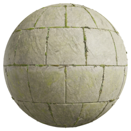</a> <b><a href="Tiles098">Tiles 098</a></b> by ambientCG · <a href="https://ambientcg.com/a/Tiles098">source</a> | <a href="Tiles099">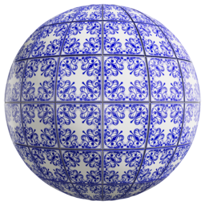</a> <b><a href="Tiles099">Tiles 099</a></b> by ambientCG · <a href="https://ambientcg.com/a/Tiles099">source</a> |  <b><a href="Tiles100">Tiles 100</a></b> by ambientCG · <a href="https://ambientcg.com/a/Tiles100">source</a> | <a href="Tiles101">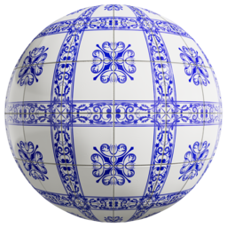</a> <b><a href="Tiles101">Tiles 101</a></b> by ambientCG · <a href="https://ambientcg.com/a/Tiles101">source</a> |
| <a href="Tiles102">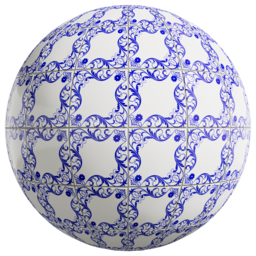</a> <b><a href="Tiles102">Tiles 102</a></b> by ambientCG · <a href="https://ambientcg.com/a/Tiles102">source</a> | <a href="Tiles103">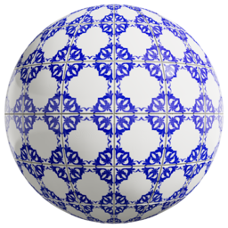</a> <b><a href="Tiles103">Tiles 103</a></b> by ambientCG · <a href="https://ambientcg.com/a/Tiles103">source</a> |  <b><a href="Tiles104">Tiles 104</a></b> by ambientCG · <a href="https://ambientcg.com/a/Tiles104">source</a> | <a href="Tiles105">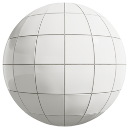</a> <b><a href="Tiles105">Tiles 105</a></b> by ambientCG · <a href="https://ambientcg.com/a/Tiles105">source</a> |
| <a href="Tiles106">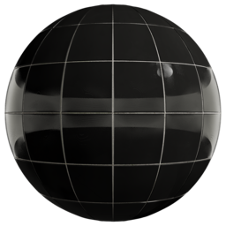</a> <b><a href="Tiles106">Tiles 106</a></b> by ambientCG · <a href="https://ambientcg.com/a/Tiles106">source</a> | <a href="Tiles107">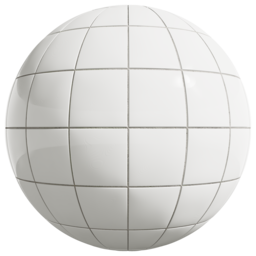</a> <b><a href="Tiles107">Tiles 107</a></b> by ambientCG · <a href="https://ambientcg.com/a/Tiles107">source</a> | <a href="Tiles108">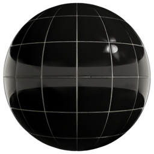</a> <b><a href="Tiles108">Tiles 108</a></b> by ambientCG · <a href="https://ambientcg.com/a/Tiles108">source</a> | <a href="Tiles109">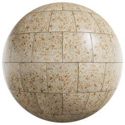</a> <b><a href="Tiles109">Tiles 109</a></b> by ambientCG · <a href="https://ambientcg.com/a/Tiles109">source</a> |
| <a href="Tiles110">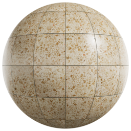</a> <b><a href="Tiles110">Tiles 110</a></b> by ambientCG · <a href="https://ambientcg.com/a/Tiles110">source</a> | <a href="Tiles111">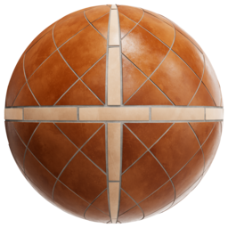</a> <b><a href="Tiles111">Tiles 111</a></b> by ambientCG · <a href="https://ambientcg.com/a/Tiles111">source</a> | <a href="Tiles112">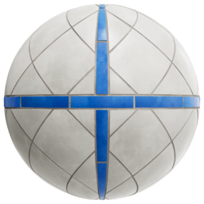</a> <b><a href="Tiles112">Tiles 112</a></b> by ambientCG · <a href="https://ambientcg.com/a/Tiles112">source</a> | <a href="Tiles113">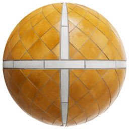</a> <b><a href="Tiles113">Tiles 113</a></b> by ambientCG · <a href="https://ambientcg.com/a/Tiles113">source</a> |
| <a href="Tiles114">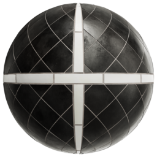</a> <b><a href="Tiles114">Tiles 114</a></b> by ambientCG · <a href="https://ambientcg.com/a/Tiles114">source</a> | <a href="Tiles115">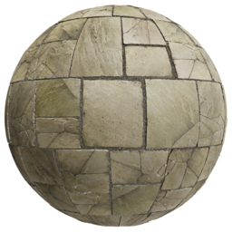</a> <b><a href="Tiles115">Tiles 115</a></b> by ambientCG · <a href="https://ambientcg.com/a/Tiles115">source</a> | <a href="Tiles116">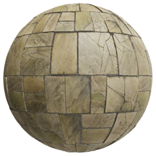</a> <b><a href="Tiles116">Tiles 116</a></b> by ambientCG · <a href="https://ambientcg.com/a/Tiles116">source</a> | <a href="Tiles117">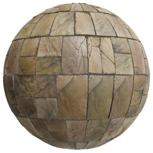</a> <b><a href="Tiles117">Tiles 117</a></b> by ambientCG · <a href="https://ambientcg.com/a/Tiles117">source</a> |
| <a href="Tiles118">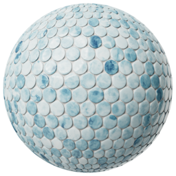</a> <b><a href="Tiles118">Tiles 118</a></b> by ambientCG · <a href="https://ambientcg.com/a/Tiles118">source</a> | <a href="Tiles119">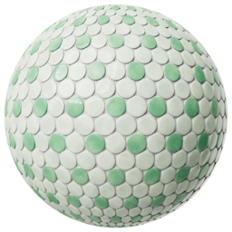</a> <b><a href="Tiles119">Tiles 119</a></b> by ambientCG · <a href="https://ambientcg.com/a/Tiles119">source</a> | <a href="Tiles120">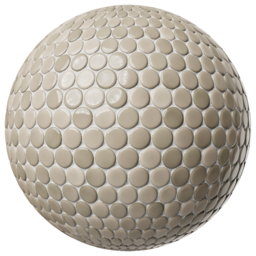</a> <b><a href="Tiles120">Tiles 120</a></b> by ambientCG · <a href="https://ambientcg.com/a/Tiles120">source</a> | <a href="Tiles121">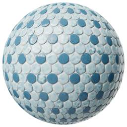</a> <b><a href="Tiles121">Tiles 121</a></b> by ambientCG · <a href="https://ambientcg.com/a/Tiles121">source</a> |
| <a href="Tiles122">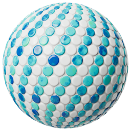</a> <b><a href="Tiles122">Tiles 122</a></b> by ambientCG · <a href="https://ambientcg.com/a/Tiles122">source</a> | <a href="Tiles123">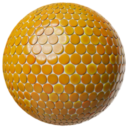</a> <b><a href="Tiles123">Tiles 123</a></b> by ambientCG · <a href="https://ambientcg.com/a/Tiles123">source</a> | <a href="Tiles124">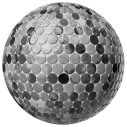</a> <b><a href="Tiles124">Tiles 124</a></b> by ambientCG · <a href="https://ambientcg.com/a/Tiles124">source</a> | <a href="Tiles125">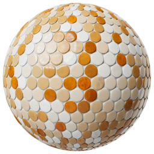</a> <b><a href="Tiles125">Tiles 125</a></b> by ambientCG · <a href="https://ambientcg.com/a/Tiles125">source</a> |
| <a href="Tiles126">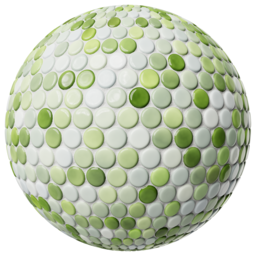</a> <b><a href="Tiles126">Tiles 126</a></b> by ambientCG · <a href="https://ambientcg.com/a/Tiles126">source</a> | <a href="Tiles127">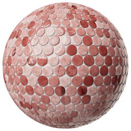</a> <b><a href="Tiles127">Tiles 127</a></b> by ambientCG · <a href="https://ambientcg.com/a/Tiles127">source</a> | <a href="Tiles128A">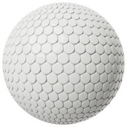</a> <b><a href="Tiles128A">Tiles 128 A</a></b> by ambientCG · <a href="https://ambientcg.com/a/Tiles128A">source</a> | <a href="Tiles128B">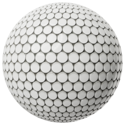</a> <b><a href="Tiles128B">Tiles 128 B</a></b> by ambientCG · <a href="https://ambientcg.com/a/Tiles128B">source</a> |
| <a href="Tiles129A">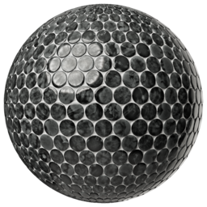</a> <b><a href="Tiles129A">Tiles 129 A</a></b> by ambientCG · <a href="https://ambientcg.com/a/Tiles129A">source</a> | <a href="Tiles129B">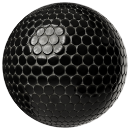</a> <b><a href="Tiles129B">Tiles 129 B</a></b> by ambientCG · <a href="https://ambientcg.com/a/Tiles129B">source</a> | <a href="Tiles130">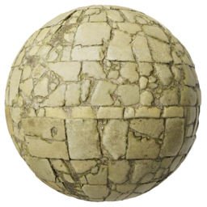</a> <b><a href="Tiles130">Tiles 130</a></b> by ambientCG · <a href="https://ambientcg.com/a/Tiles130">source</a> | <a href="Tiles131">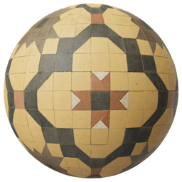</a> <b><a href="Tiles131">Tiles 131</a></b> by ambientCG · <a href="https://ambientcg.com/a/Tiles131">source</a> |
| <a href="Tiles132A">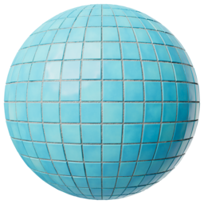</a> <b><a href="Tiles132A">Tiles 132 A</a></b> by ambientCG · <a href="https://ambientcg.com/a/Tiles132A">source</a> | <a href="Tiles132B">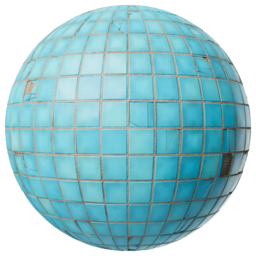</a> <b><a href="Tiles132B">Tiles 132 B</a></b> by ambientCG · <a href="https://ambientcg.com/a/Tiles132B">source</a> | <a href="Tiles132C">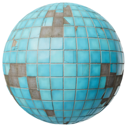</a> <b><a href="Tiles132C">Tiles 132 C</a></b> by ambientCG · <a href="https://ambientcg.com/a/Tiles132C">source</a> |  |

---

Kept up to date by this repository's own [update workflow](.github/workflows/update.yml), with code and plan from [cc0-mirror](https://github.com/zuujis-cc0/cc0-mirror). Something wrong? [Open an issue there](https://github.com/zuujis-cc0/cc0-mirror/issues/new) or use the [private report form](https://games.zuujis.com/report).
